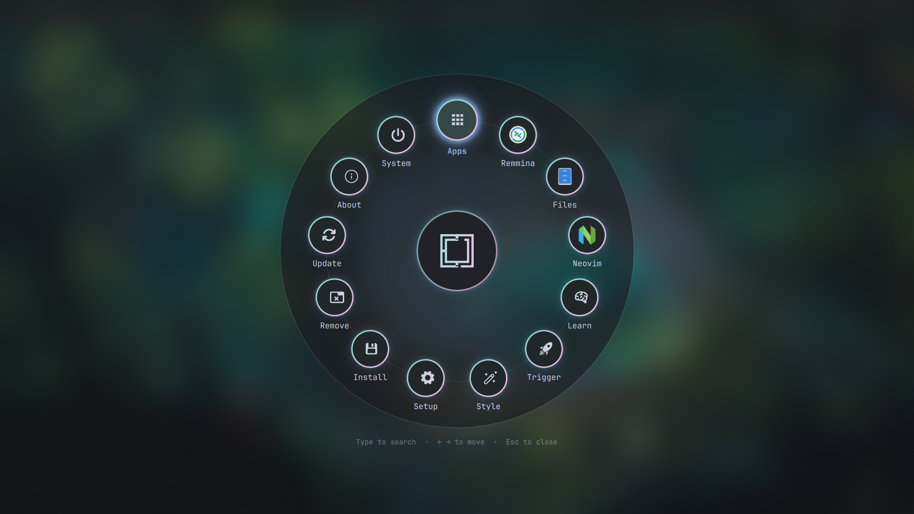
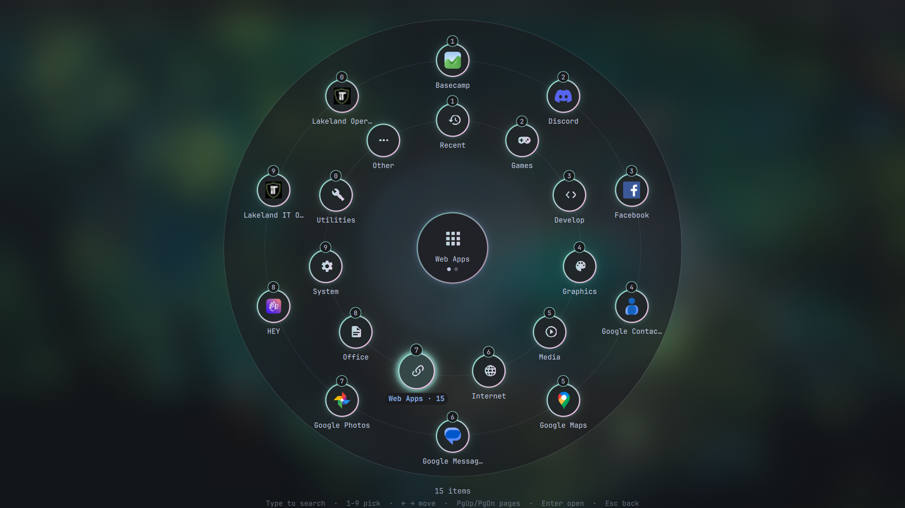

# Radial Menu for Omarchy

A radial (pie) take on the Omarchy menu. Menu items sit on a ring around a hub
instead of in a list, and the two menus too big for one ring, **Apps** and
**Install**, open category rings. Pick a category to see its apps.




## Features

- Every Omarchy menu and submenu is shown as a ring. Small menus show all their items at once.
- **Apps** groups your installed apps by freedesktop category and puts web apps in their own group.
- **Install** uses the same rings: Style, Development, Editor, AI, Gaming and the rest, plus a Packages group.
- **Favourites**: pin any app with `Ctrl+P` or a right-click. Pins come first in Apps and get a ★.
- **Shortcuts**: up to three pinned or recent apps sit on the main ring next to Apps.
- **Remembers your place**: each menu reopens on the item you last used (for 12 hours).
- **Type to search**: typing switches to the normal searchable list.
- The ring follows your theme's colours.

## Install

```bash
omarchy plugin add https://github.com/JohnnyCopenhaver/omarchy-radial-menu.git --enable
```

The plugin replaces the built-in `omarchy.menu`. `Super+Space`, the Omarchy
button in the bar, and `omarchy menu ...` all open the radial menu, and the
menu definitions and your `~/.config/omarchy/extensions/omarchy-menu.jsonc`
work as before.

To go back to the stock menu:

```bash
omarchy plugin disable jlc.radial-menu
```

## Keys

| Key | Action |
| --- | --- |
| `←` `→` / mouse wheel | Move around the ring |
| `Enter` / click | Open or run |
| `1`–`9`, `0` | Pick the numbered item |
| `Home` / `End` | First / last item |
| `PgUp` / `PgDn` / dots in the hub | Change page on long rings |
| `Backspace` / right-click the disc / click the hub | Go back |
| `Ctrl+P` / right-click an app | Pin or unpin a favourite |
| `Delete` on an app | Uninstall it (asks first) |
| Type anything | Search |
| `Esc` | Close |

## Notes

- This is a fork of Omarchy's built-in menu plugin (Omarchy 4.0.x).
  `MenuModel.js` and most of `Menu.qml` come from upstream; the ring UI is
  `RadialMenu.qml`. A large Omarchy update to the built-in menu may need a
  matching update here.
- State is kept in `~/.local/state/omarchy/radial-menu-state.json` (pins and
  last position) and `radial-menu-usage.json` (recent apps).
- After editing the QML, run `omarchy restart shell`.

## License

MIT. Includes code from [Omarchy](https://github.com/basecamp/omarchy), © 37signals, MIT.
